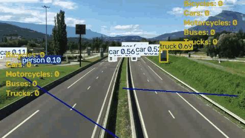

# Vehicle Detection and Counting with YOLOv8


A computer-vision pipeline that counts traffic in video, **by vehicle type and by direction of travel**.
Each frame goes through YOLOv8 for detection, YOLOv8's built-in tracker keeps a persistent ID on every object
across frames, and a vehicle is counted when its centre crosses one of two counting lines drawn across the
road. Running counts are drawn on the video and written to a log file every second.



*Each box carries the track ID, class and confidence. The two blue lines are the counting lines, the running
counts for each direction are shown on each side, and a triangle marks a vehicle that is approaching a line.
Full-length clip: [docs/demo.mp4](docs/demo.mp4).*

A sample clip is included in the repository, so the pipeline runs straight after install, with no dataset to download.

---

## Results on the included sample

601 frames, 1280×720 at 30 fps, processed at half size with `yolov8m`:

| Direction | Car | Truck | Bicycle | Motorcycle | Bus | Total |
|---|---|---|---|---|---|---|
| UP   | 8  | 5 | 0 | 0 | 0 | **13** |
| DOWN | 13 | 1 | 0 | 0 | 0 | **14** |

These are the model's counts, reproducible on any machine with the same weights. They have not been checked
against a hand count of the clip, so they are not presented as an accuracy figure (see Known limitations).

---

## What it does

- **Detects six classes**: person, bicycle, car, motorcycle, bus and truck (COCO classes `0, 1, 2, 3, 5, 7`).
  All other COCO classes are filtered out at inference time. Vehicles are counted; people are tracked for
  rider pairing and are not counted.
- **Tracks objects across frames** with YOLOv8's built-in tracker (`model.track(..., persist=True)`), so each
  vehicle keeps the same ID from frame to frame.
- **Counts by direction**: an "up" line and a "down" line, one for each side of the road. A vehicle is counted
  when its centre moves from one side of a line to the other.
- **Counts each vehicle once**: an ID that has already been counted is remembered and never counted again.
- **Shows live results**: bounding boxes, track IDs, both counting lines, per-class counts for each direction,
  and a marker on each vehicle that is approaching a line.
- **Logs counts every second** to a `.log` file named after the video, and prints a final summary table
  whether the video ends or you stop it.
- **Pairs likely riders with vehicles (experimental)**: a person who stays within 50 px of the same vehicle for
  more than 25 frames is linked to it on screen with a red line.

---

## How the counting works

1. **Read** – OpenCV reads the video frame by frame and resizes each frame to half its size.
2. **Detect and track** – YOLOv8 returns a box, a class and a confidence score for each object, restricted to
   the six classes above; the tracker attaches a persistent ID to each box.
3. **Assign a side** – for each counting line, the 2D cross product of the line's direction vector and the
   vector to the vehicle's centre gives a sign: which side of the line the vehicle is on. On first sighting,
   the vehicle is noted as approaching the UP or the DOWN line.
4. **Count the crossing** – when that sign flips, the vehicle has crossed. The count for its class and
   direction goes up by one, and its ID is stored so it is never counted twice.

The crossing check runs once per vehicle per frame (`LineCounter` in `track.py`), so a vehicle is counted even
when it is the only object on screen. Rider pairing runs separately (`RiderPairing`) and never changes the counts.

The two lines are defined in pixel coordinates on the half-size frame and are tuned to the sample camera:

```python
UP_LINE   = ((320, 230), (620, 250))
DOWN_LINE = ((60, 200), (340, 380))
```

---

## Getting started

### Install

Python 3.9 or later.

```bash
git clone https://github.com/codedchaitanya/Vehicle_detection_and_counting.git
cd Vehicle_detection_and_counting

python -m venv venv
source venv/bin/activate        # Windows: venv\Scripts\activate

pip install -r requirements.txt
```

`lap` is listed in `requirements.txt` because the YOLOv8 tracker needs it for track association.

### Run

```bash
python Major/track.py
```

This runs on the included sample clip. A window opens with the annotated video and live counts; press **`q`** to
stop early. The final counts table is printed in the terminal either way, and per-second counts are written to
`Major/sample_video.log`.

Model weights are not stored in the repository: `yolov8m.pt` (about 50 MB) downloads automatically into
`Major/weights/` on the first run.

### Options

| Option | What it does |
|---|---|
| `--video PATH` | Run on your own footage instead of the sample clip |
| `--weights NAME` | Use another YOLOv8 model, e.g. `yolov8n.pt` (faster) or `yolov8l.pt` (more accurate) |
| `--save out.mp4` | Also save the annotated video |
| `--no-display` | Run without a window (servers, CI); counts are still printed and logged |

```bash
python Major/track.py --video my_clip.mp4 --weights yolov8n.pt --save my_clip_counted.mp4
```

For a different camera angle, adjust `UP_LINE` and `DOWN_LINE` at the top of `track.py` to cross the road in
your footage (coordinates are on the half-size frame), otherwise nothing will be counted.

---

## Project structure

```
requirements.txt               # Dependencies
docs/                          # Demo GIF and video
Major/
├── track.py                   # Main pipeline: detection, tracking, line-crossing counts, logging
├── video/                     # Sample clip
├── weights/                   # YOLOv8 weights, downloaded on first run (not committed)
├── templates/                 # Digit templates (0-9) for reading the CCTV timestamp
├── helper.py                  # Bounding-box conversions, annotation reader, class colour map
│
│   Development and experiment scripts
├── vehicle_detection.py       # Batch detection with IoU-based rider suppression (experiment)
├── infer_vid.py               # Exports frames and YOLO-format annotations from a video
├── counting.py                # Draws the exported annotations on a frame for checking
├── dataset_preprocess.ipynb   # Class distribution of the Dhaka traffic dataset (imbalance check)
├── train.py                   # Fine-tunes YOLOv8n on the Dhaka traffic dataset (10 epochs)
├── val.py                     # Evaluates the fine-tuned model: mAP50, mAP75, mAP50-95, per-class mAP
└── template_matching.py       # Reads the on-screen CCTV date and time with pytesseract OCR
```

The development scripts are a record of the experiments: fine-tuning on South Asian traffic, which COCO does
not cover well, and OCR of the CCTV timestamp. They expect datasets and trained weights that are not part of
this repository (`../datasets/Patiala CCTV/`, `../datasets/dhaka_traffic_dataset/`, `runs/detect/train4/`).
`track.py` is the entry point that runs out of the box.

---

## Tech stack

| Tool | Role |
|---|---|
| **YOLOv8 (Ultralytics)** | Object detection, built-in multi-object tracking, fine-tuning and evaluation |
| **OpenCV** | Video input and output, resizing, drawing boxes, lines, markers and counts |
| **pytesseract** | OCR of the timestamp printed on the CCTV footage |
| **NumPy, Matplotlib** | Annotation processing and dataset class-distribution plots |

---

## Known limitations and next steps

- **No ground-truth check yet.** The counts have not been compared with a hand-counted clip, so no accuracy
  figure is claimed. Distant vehicles can switch between car and truck from frame to frame; a vehicle is
  counted under the class it has when it crosses.
- **Rider pairing is display-only.** A paired rider and motorcycle are linked on screen but not merged into one
  object. The sample clip is a highway with no riders, so this part is untested on it.
- **Counting lines are fixed** to the sample camera angle and need new coordinates for other footage.
- **The fine-tuned Dhaka model is separate from the counter.** `track.py` uses the standard COCO-trained
  YOLOv8; the next step is to plug in the fine-tuned model for local vehicle types such as auto-rickshaws.
